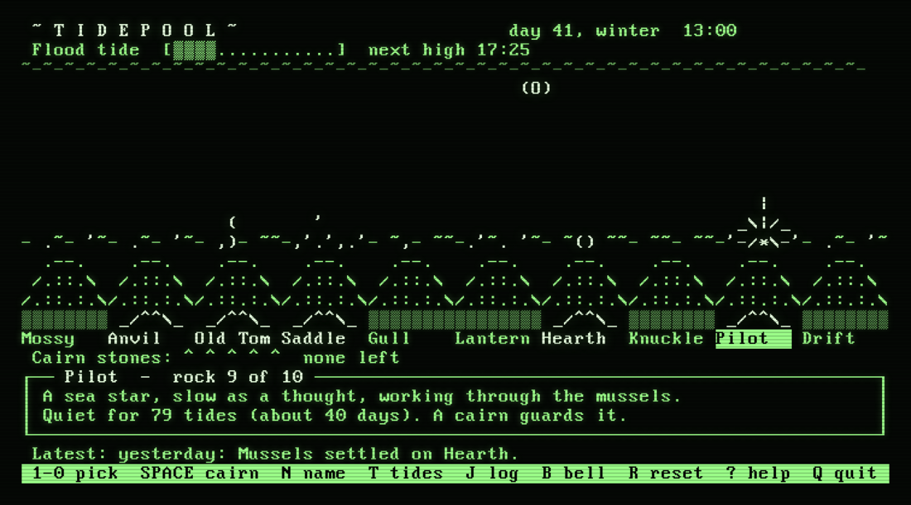

# Tidepool (TIDEPOOL)

A very slow garden you can't control: ten rocks and a tide table. Things grow when the tide is
in, and you only decide what not to disturb. An idle game built around the real-time clock gap:
come back after a week away and the pool has changed.

You have five cairn stones. A rock with a cairn is left alone; when you go, you wade out across
the rocks that have none, and what lives there is stepped on and starts smaller. The rare things
(anemones, sea stars) only come to rocks that stay quiet for days. There is nothing to win:
choose, then give it time. Name your rocks (N), read the tide table (T) and the journal (J),
ring the bell when a tide turns (B), or start a new pool (R). Seasons follow the date.

Z80 assembly, CP/M 2.2, 80x24, VT100 (line drawing, dim, bold, blink, reverse) / VT52 / ADM-3A.
Written for [DigitalRerun](https://github.com/cstroie/digital-rerun), where it sits on the shelf,
and where the machine has a clock device on port 20 to read the date and time from.
Player's guide: [docs/PLAYING.txt](docs/PLAYING.txt). Design notes: [DESIGN.md](DESIGN.md).

    sh build.sh        art.inc (node mkart.js), then TIDEPOOL.COM (pasmo)
    node --test test/  needs a DigitalRerun checkout (ROOT=<dir>, default ../../..)

MIT licence.
